### My products

- [Doralingo](https://doralingo.com): an English learning platform
- [Musta9bali](https://musta9bali.com): Moroccan study options after the baccalaureate
- [Bayan](https://bayanquran.com): Quran recitations, streamed or offline

### At Safe Apps, since 2022

- [eGrow](https://egrow.com): a CRM and messaging platform for ecommerce teams
- [Beloud](https://play.google.com/store/apps/details?id=com.beloud): a social news and video platform
