```text
██╗   ██╗ █████╗ ███████╗███████╗██╗██████╗
╚██╗ ██╔╝██╔══██╗██╔════╝██╔════╝██║██╔══██╗
 ╚████╔╝ ███████║███████╗███████╗██║██████╔╝
  ╚██╔╝  ██╔══██║╚════██║╚════██║██║██╔══██╗
   ██║   ██║  ██║███████║███████║██║██║  ██║
   ╚═╝   ╚═╝  ╚═╝╚══════╝╚══════╝╚═╝╚═╝  ╚═╝
```

<picture>
  <source media="(prefers-color-scheme: dark)" srcset="profile/typing-dark.svg">
  <source media="(prefers-color-scheme: light)" srcset="profile/typing-light.svg">
  
</picture>

### My products

- **[Doralingo](https://doralingo.com)**: an English learning platform for adults, with reading, listening, grammar and dictation lessons. Kotlin and Spring Boot backend, Nuxt web app, Flutter app for Android and iOS.
- **[Musta9bali](https://musta9bali.com)**: a catalogue of the schools, programs and entrance exams open to Moroccan students after the baccalaureate. Spring Boot backend, Nuxt web app, Flutter app for Android and iOS.
- **[Bayan](https://bayanquran.com)**: an app for listening to Quran recitations, streamed or offline. Spring Boot backend, Nuxt web app, Android app.

### At Safe Apps, since 2022

- **[eGrow](https://egrow.com)**: a CRM and messaging platform for ecommerce teams. Laravel and GraphQL backend, Nuxt web app, Flutter app.
- **[Beloud](https://play.google.com/store/apps/details?id=com.beloud)**: a social news and video app. PHP backend, Android app.

The code for these is private. My open-source tools are pinned below.



<picture>
  <source media="(prefers-color-scheme: dark)" srcset="profile/snake-dark.svg">
  <source media="(prefers-color-scheme: light)" srcset="profile/snake.svg">
  
</picture>
